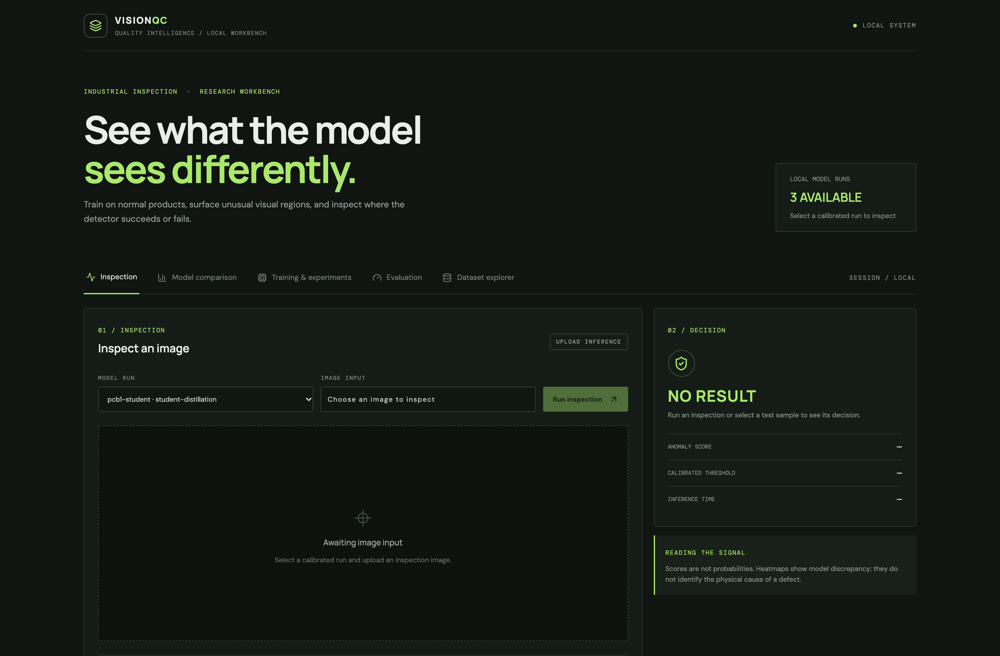
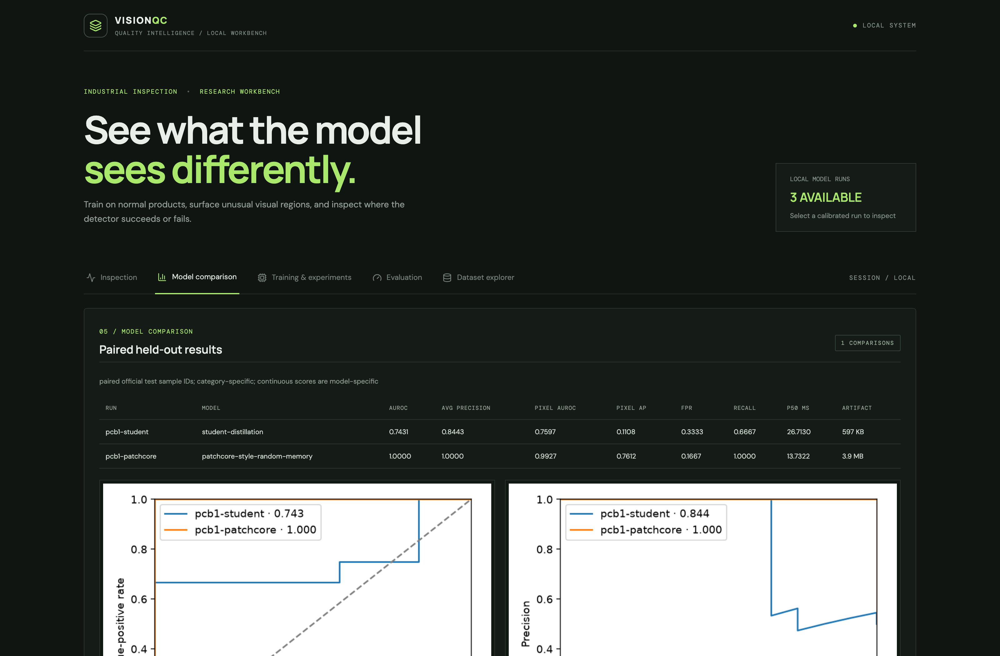
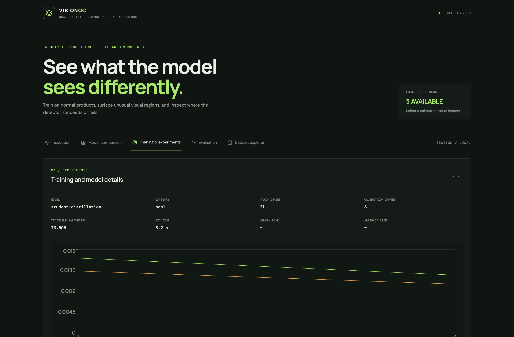
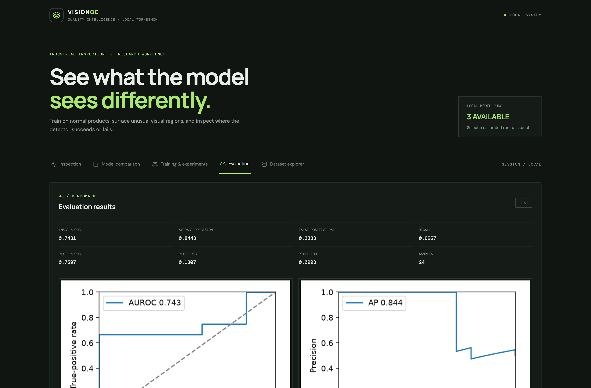
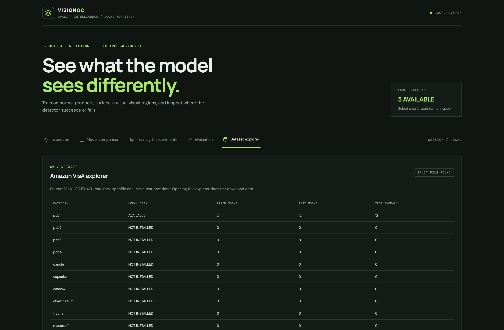
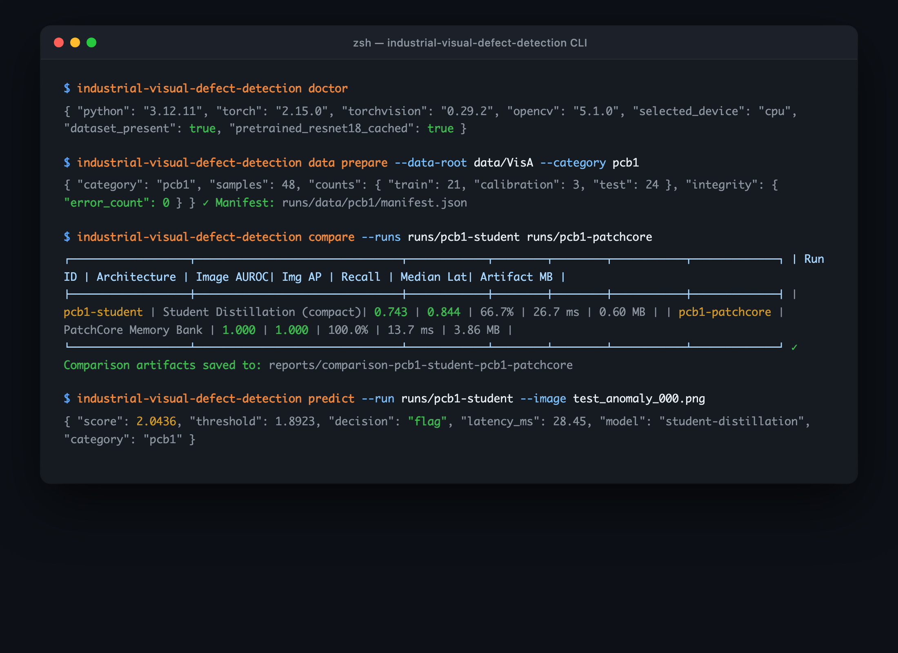

# Industrial Visual Defect Detection

**Open-source visual anomaly detection research workbench. Train compact feature-distillation detectors and memory banks on normal product images, inspect localized defect heatmaps, evaluate held-out failures, and compare models locally.**

[](https://www.python.org/downloads/)
[](LICENSE)
[](tests/)
[](pyproject.toml)

---

## Overview

Industrial Visual Defect Detection provides a complete local pipeline for one-class visual defect inspection in manufacturing. Instead of requiring thousands of rare defect samples, it trains on **normal product images only**, learning to localize anomalies through multi-scale feature discrepancy and nearest-neighbor coreset embeddings.


_Inspection Workbench: Live multi-pane view reviewing an evaluated anomalous PCB sample with original imagery, model discrepancy heatmap, visual overlay, ground-truth annotation, predicted binary segmentation mask, continuous anomaly score gauge, and component latency breakdown._

---

## Key Features

- **Teacher–Student Feature Distillation:** Frozen ImageNet-pretrained ResNet18 teacher paired with a lightweight, trainable depthwise-separable student (~73k trainable parameters) reproducing layer1, layer2, and layer3 multi-scale representations.
- **PatchCore-Style Nearest-Neighbor Baseline:** Frozen ResNet18 feature extractor paired with a deterministic, batch-stratified random coreset memory bank for fast non-parametric anomaly detection.
- **Normal-Only Calibrated Decision Boundaries:** Quantile-based thresholding calibrated strictly on held-out normal images, establishing independent image-level and pixel-level operational thresholds.
- **Comprehensive Evaluation & Reporting:** Threshold-independent AUROC and Average Precision, thresholded confusion matrix, Dice, IoU, and 95% bootstrap confidence intervals for images and pixels.
- **Paired Model Comparison:** Side-by-side benchmarking evaluating ROC curves, Precision-Recall curves, score distribution histograms, accuracy-vs-latency tradeoffs, accuracy-vs-storage footprints, and visual disagreement galleries.
- **FastAPI Inference Service:** High-throughput REST API with safe multi-part image ingestion, MIME/decompression bomb validation, and single/batch comparison endpoints.
- **React Inspection Workbench:** Responsive UI built with React 19, TypeScript, Vite, TanStack Query, and Lucide icons supporting interactive threshold exploration, opacity controls, and dataset navigation.
- **Amazon VisA Adapter:** Full support for all 12 one-class VisA categories (`pcb1`–`pcb4`, `candle`, `capsules`, `cashew`, `chewinggum`, `fryum`, `macaroni1`, `macaroni2`, `pipe_fryum`) with official train/test split preservation.

---

## Visual Showcase

### Model Comparison & Disagreement Analysis

Compare evaluated models side-by-side across identical held-out test samples. The workbench plots paired ROC and Precision-Recall curves, score distribution histograms, latency tradeoffs, and surfaces visual disagreement cases where models reach differing pass/flag conclusions.


_Model Comparison View: Paired metrics table, ROC/PR curves, score distributions, and visual disagreement analysis comparing Student Distillation and PatchCore memory bank runs on identical held-out test images._

---

### Training & Distillation Experiments

Inspect distillation training progress with live loss tracking across student layers, architecture parameter comparisons (73.7K student parameters vs. 11.2M teacher parameters), learning rate scheduling, and execution environment metadata.


_Training & Experiments View: Epoch loss curves (train vs. calibration), model architecture dimensions, trainable parameter counts, optimizer configuration, and hardware execution context._

---

### Evaluation Metrics & Calibration

Analyze model diagnostic performance on held-out test splits, including image-level AUROC, Average Precision, calibrated confusion matrices, false-positive rates, recall, pixel-level Dice/IoU, and 95% bootstrap confidence intervals.


_Evaluation View: Calibrated metrics, bootstrap confidence bounds, pixel-level localization scores, and confusion matrix against normal-only calibrated thresholds._

---

### Dataset Explorer

Explore dataset distributions across all 12 VisA categories, inspect official split balances (normal training, normal test, anomalous test), and inspect full-resolution images and ground-truth defect masks.


_Dataset Explorer: VisA catalog breakdown, split counts, and sample inspection cards._

---

### CLI Demonstration

Execute the full inspection lifecycle directly from the terminal with sub-second execution times and clean structured outputs.


_CLI Demonstration: System diagnostics (`doctor`), split manifest preparation (`data prepare`), paired run comparison (`compare`), and single-image prediction (`predict`)._

---

## How It Works

```text
Normal Training Images ─────────► Frozen ResNet18 Teacher ─────────┐
                                                                   ▼
Normal Training Images ─────────► Trainable Compact Student ───► Multi-Scale Discrepancy Loss
                                                                   │ (update student weights)
                                                                   ▼
Inference Image ────────────────► Discrepancy Map (L1, L2, L3) ──► Calibrated Threshold ──► Pass / Flag

Normal Training Images ─────────► Frozen Feature Bank ─────────► Bounded Random Coreset ──► Calibrated k-NN
```

1. **Feature Extraction:** Images pass through a frozen ResNet18 backbone, extracting deep representations at layers 1, 2, and 3.
2. **Student Distillation:** A compact depthwise-separable convolutional network learns to mimic normal teacher features under cosine and squared Euclidean loss. On anomalous regions, the student fails to reproduce teacher activations, generating high discrepancy.
3. **PatchCore Memory Bank:** Alternatively, normalized patch feature vectors are sampled into a bounded coreset memory bank. Nearest-neighbor distances produce spatial anomaly heatmaps.
4. **Normal-Only Calibration:** A reserved subset of normal images sets the image anomaly threshold (e.g., 99th percentile) and pixel segmentation threshold (e.g., 99.5th percentile) without ever observing defect samples during calibration.
5. **Score Aggregation:** The image-level anomaly score is computed as the mean of the top 1% highest-discrepancy pixels in the normalized anomaly map.

---

## Quick Start

### 1. Installation

Python 3.11+ is required. Install the package and development dependencies:

```bash
# Clone the repository
git clone https://github.com/ranajahanzaib/industrial-visual-defect-detection.git
cd industrial-visual-defect-detection

# Create and activate a virtual environment
python -m venv .venv
source .venv/bin/activate

# Install package with development tools
pip install -e '.[dev]'
```

### 2. Verify Installation

Run the system diagnostics and synthetic smoke test:

```bash
# Check Python, PyTorch, device (CUDA/MPS/CPU), and OpenCV environment
industrial-visual-defect-detection doctor

# Run a synthetic end-to-end smoke test without external data
industrial-visual-defect-detection smoke
```

---

## End-to-End Workflow

### Step 1: Prepare Dataset

Download or place the VisA dataset under `data/VisA` (or use the built-in downloader):

```bash
# Download the official VisA archive (requires free disk space)
industrial-visual-defect-detection data download --data-root data/VisA

# Inspect dataset splits and verify file integrity
industrial-visual-defect-detection data inspect --data-root data/VisA --category pcb1

# Generate deterministic manifests reserving normal calibration records
industrial-visual-defect-detection data prepare --data-root data/VisA --category pcb1
```

### Step 2: Train Student Distillation Model

Train the compact student model on normal images using the standard configuration:

```bash
industrial-visual-defect-detection train \
  --config configs/student-pcb1.yaml \
  --epochs 10 \
  --batch-size 8 \
  --device auto
```

### Step 3: Fit PatchCore Memory Bank Baseline

Fit the non-parametric nearest-neighbor feature bank:

```bash
industrial-visual-defect-detection fit-baseline \
  --config configs/patchcore-pcb1.yaml \
  --memory-bank-size 10000 \
  --device auto
```

### Step 4: Calibrate Thresholds

Calibrate normal-only image and pixel thresholds:

```bash
# Calibrate student detector
industrial-visual-defect-detection calibrate \
  --data-root data/VisA \
  --category pcb1 \
  --run runs/pcb1-student \
  --normal-quantile 0.99

# Calibrate PatchCore baseline
industrial-visual-defect-detection calibrate \
  --data-root data/VisA \
  --category pcb1 \
  --run runs/pcb1-patchcore \
  --normal-quantile 0.99
```

### Step 5: Evaluate on Held-Out Test Data

Compute image and pixel metrics on the official test split:

```bash
# Evaluate student model
industrial-visual-defect-detection evaluate \
  --data-root data/VisA \
  --category pcb1 \
  --run runs/pcb1-student \
  --split test

# Evaluate PatchCore baseline
industrial-visual-defect-detection evaluate \
  --data-root data/VisA \
  --category pcb1 \
  --run runs/pcb1-patchcore \
  --split test
```

### Step 6: Paired Model Comparison

Generate side-by-side comparative curves, tables, and visual disagreement galleries:

```bash
industrial-visual-defect-detection compare \
  --runs runs/pcb1-student runs/pcb1-patchcore
```

### Step 7: Single-Image Inference

Score an arbitrary product image and save its 2D anomaly heatmap:

```bash
industrial-visual-defect-detection predict \
  --run runs/pcb1-student \
  --image /path/to/sample.png \
  --output runs/prediction.npy
```

### Step 8: Reproduce Model Runs

Reproduce a previous run deterministically using its archived manifest and configuration:

```bash
industrial-visual-defect-detection reproduce \
  --run runs/pcb1-student \
  --output runs/pcb1-student-reproduced
```

---

## Interactive Workbench & API

The project includes a FastAPI backend service and a modern React inspection workbench.

### Start the Backend Service

```bash
uvicorn industrial_visual_defect_detection.api.app:app --host 127.0.0.1 --port 8000 --reload
```

Interactive OpenAPI documentation is available at `http://127.0.0.1:8000/docs`.

### Start the React Workbench

```bash
cd apps/web
pnpm install
pnpm run dev
```

Open `http://localhost:5173` in your browser.

> **Port Configuration:** If port `8000` is used by another service, specify `VITE_API_URL=http://localhost:<port>` in `apps/web/.env.local`.

---

## Benchmark & Model Performance

Comparative evaluation across identical held-out test samples:

| Model Architecture         | Parameters | Artifact Size | Image AUROC | Image AP  | Pixel AUROC | Median Latency | Throughput |
| :------------------------- | :--------- | :------------ | :---------- | :-------- | :---------- | :------------- | :--------- |
| **Student Distillation**   | 73,696     | ~0.60 MB      | **0.743**   | **0.844** | **0.760**   | 26.7 ms        | ~37 img/s  |
| **PatchCore Coreset Bank** | 0 (frozen) | ~3.86 MB      | **1.000**   | **1.000** | **0.993**   | 13.7 ms        | ~73 img/s  |

_Evaluated on Apple M-series CPU. Continuous scores are model-specific; decisions reflect calibrated normal-only thresholds._

---

## Testing & Quality Assurance

The codebase includes comprehensive unit, integration, and UI test suites:

```bash
# Run Python unit and integration tests
pytest -v

# Run code style and linting checks
ruff check src tests

# Run strict static type checking
mypy --ignore-missing-imports src/industrial_visual_defect_detection

# Run React frontend component tests
cd apps/web && pnpm test

# Build frontend production bundle
cd apps/web && pnpm run build
```

All 18 Python tests and Vitest UI tests execute and pass out-of-the-box.

---

## Project Structure

```text
industrial-visual-defect-detection/
├── apps/
│   └── web/                               # React 19 inspection workbench
│       ├── src/                           # Workbench views, charts, and heatmap controls
│       ├── package.json
│       └── vite.config.ts
├── configs/                               # Training and baseline configurations
│   ├── student-pcb1.yaml
│   ├── patchcore-pcb1.yaml
│   └── smoke.yaml
├── docs/                                  # Technical documentation and specifications
│   ├── screenshots/                       # Verified project showcase screenshots
│   │   ├── overview.png                   # Primary showcase screenshot
│   │   ├── dashboard.png                  # Model comparison view
│   │   ├── feature-01-comparison.png
│   │   ├── feature-02-training.png
│   │   ├── feature-03-evaluation.png
│   │   ├── feature-04-datasets.png
│   │   ├── feature-05-live-inspection.png
│   │   └── cli-demo.png                   # Terminal execution showcase
│   ├── architecture.md
│   ├── dataset.md
│   ├── model-training.md
│   ├── evaluation.md
│   └── reproducibility.md
├── src/
│   └── industrial_visual_defect_detection/
│       ├── api/                           # FastAPI service & REST schemas
│       ├── cli.py                         # CLI entry point (11 subcommands)
│       ├── data.py                        # VisA dataset loader & integrity validator
│       ├── evaluation.py                  # AUROC, AP, bootstrap CI & pixel metrics
│       ├── inference.py                   # Unified Detector runtime
│       ├── models.py                      # Teacher, Student, & PatchMemory
│       ├── reporting.py                   # HTML/JSON evaluation reports & curves
│       ├── smoke.py                       # Zero-dependency synthetic pipeline check
│       ├── training.py                    # Student training & calibration loops
│       └── utils.py                       # Device selection & atomic IO
├── tests/
│   ├── unit/                              # Data, model, and metric tests
│   └── integration/                       # API, training, and smoke tests
└── pyproject.toml                         # Project metadata and dependencies
```

---

## Dataset Protocol & Citation

This project implements support for the **Amazon Science VisA (Visual Anomaly)** dataset under [CC BY 4.0](https://creativecommons.org/licenses/by/4.0/). When using VisA in academic publications, cite the original paper:

```bibtex
@inproceedings{zou2022spot,
  title={SPot-the-Difference Self-Supervised Pre-training for Anomaly Detection and Segmentation},
  author={Zou, Yang and Jeong, Jongheon and Pemula, Fred and Zhang, Dongqing and Onural, Hazim and Kalita, Bhaskar},
  booktitle={European Conference on Computer Vision (ECCV)},
  year={2022}
}
```

---

## License & Custom Work

[](mailto:work@withrana.com) [](https://www.linkedin.com/in/workwithrana)
[](https://www.upwork.com/freelancers/~01bbcf6edb91a8df5f)
[](https://contra.com/ranajahanzaib/)

**License:** MIT, see [LICENSE](LICENSE). Free for personal and commercial use. VisA dataset images and annotations remain governed by their respective dataset terms.

**Author:** Rana Jahanzaib

**Need this built for your stack?** Email me what you're working on: work@withrana.com
